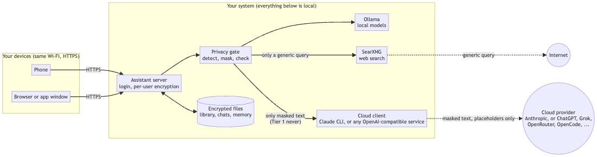
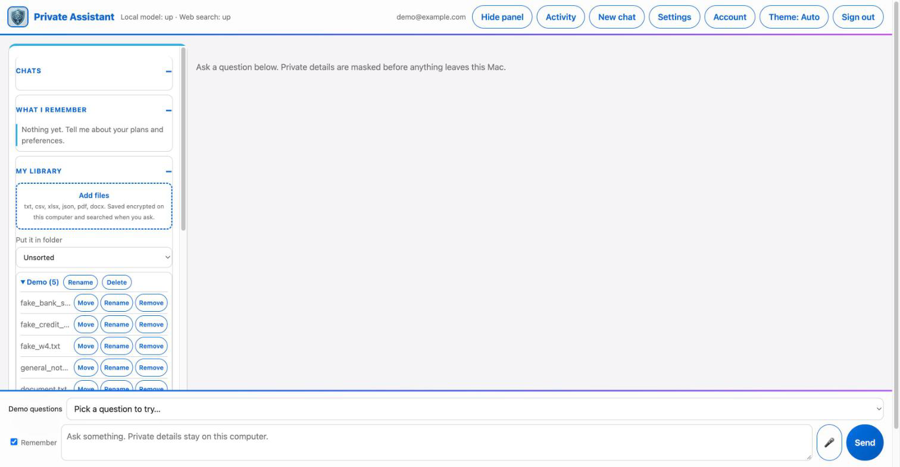
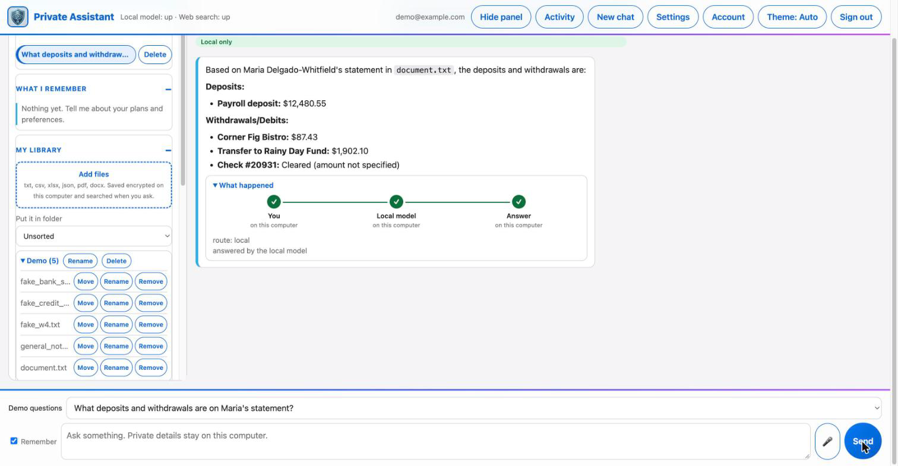
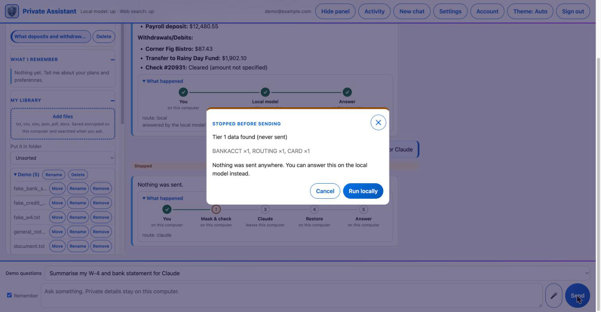
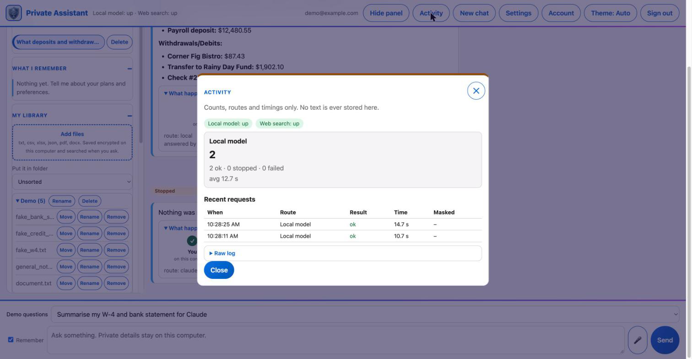

# privacy-hybrid: a local-first private AI assistant for personal and financial documents

privacy-hybrid is an open-source, privacy-first AI assistant that runs on your own computer. Your documents, chats and memory stay local and are answered by a local model (Ollama). When you choose a cloud model, the cloud only sees masked text, and anything that must never leave (SSN, card number, password, bank account or routing number) stops the request. Web search sees only a generic query.

Its main idea is the combination of local data control, selective cloud access, sensitive-data masking and several independent layers of checks, so a strong cloud model can help with a bank statement or tax paper without learning who you are.

**Security dashboard:** https://hgharsha.github.io/privacy-hybrid/ (generated from `docs/security/REMEDIATION_TRACKER.md`; a self-assessment, not an independent audit).
- FAQ and known limits: FAQ.md. Plan: PLAN.md. Data rules: PII-STANDARD.md (conditionally approved). Threats: docs/THREAT-MODEL.md. Proof: VERIFY.md.
- How data flows (pictures): docs/DATA-FLOW.md. Install and share: Quick start below; VERIFY.md "Run it" for the by-hand run. Verify: `./scripts/verify.sh`.
- Code: src/privhybrid (detect, vault, egress, local, ingest, pipeline, server), static/ (web UI), tests/ (fake data only).

## Use at your own risk

This is a personal project, shared in case someone finds it useful. It is free (MIT license, see `LICENSE`) and comes with no warranty and no support. It is not a security product and has not been independently audited. Masking can miss things, so do not rely on it alone for data you cannot afford to expose. You are responsible for how you run it, what you put into it and where you expose it. The author accepts no liability for any loss, leak or damage. Fork it, change it, reuse it, at your own risk.

## How data flows



Everything private stays on the system that runs the assistant. Only a generic search query or masked text ever leaves it. The full set of diagrams (one question step by step, what is stored, scheduled jobs, network, monitoring) is in [docs/DATA-FLOW.md](docs/DATA-FLOW.md).

## Use case

You have a personal or financial document (bank statement, invoice, tax paper) and want help from a strong cloud model without handing it your identity. The gateway keeps the real data on your machine, sends the cloud only masked placeholders (`[PERSON_1]`, `[AMOUNT_2]`), then restores the real values in the answer. Anything that must never leave (SSN, card number, password, routing/account number) stops the request and asks you.

The cloud step uses Claude by default. You can point it at any OpenAI-compatible service (ChatGPT, Grok, OpenRouter, OpenCode, ...) in Settings; that option is **not tested with real providers yet**, the provider sees the masked text, and it has its own retention and training terms. See FAQ.md.

Typical uses: summarise a statement, draft an email about an invoice, compare your savings to current public rates, ask questions about a file, all without the cloud ever seeing who you are.

## Who it is for, and what it is not

For people who want AI help with personal or financial documents (bank and card statements, invoices, tax forms) and want to keep control of where that data goes: privacy-minded individuals, households sharing one computer, and tinkerers running local models. It is not a security product, not independently audited, and not a guarantee that nothing can leak; see "Use at your own risk" above and the known limits in [FAQ.md](FAQ.md).

## Layers of protection

1. **Local first.** Library, search index, chats and memory are encrypted per user on disk and answered by a local model on this computer.
2. **Detect and block.** SSNs, card numbers, passwords, and bank account and routing numbers are never sent; the request stops and asks you.
3. **Mask.** Names, addresses, amounts and similar details become placeholders (`[PERSON_1]`) before any cloud step, then are restored in the answer.
4. **Recheck and local privacy check.** The masked text is scanned again and a local model looks for anything the rules missed. Bigger local models do better here.
5. **You confirm.** Review before sending shows the exact text; text that might still be sensitive forces a second confirmation.
6. **Network limits.** The app itself can only reach this computer; an optional operating-system firewall setup and separate-user testing add a second wall. Details and limits: [docs/SECURITY.md](docs/SECURITY.md).

Every layer has known limits and none is a guarantee. The status of each reviewed weakness is on the [security dashboard](https://hgharsha.github.io/privacy-hybrid/).

## Supported platforms and models

| Area | Status |
|---|---|
| macOS | Tested |
| Linux (Ubuntu) | Tested; scheduled jobs need a desktop keychain |
| Windows | Written, **not tested** |
| Local models | Ollama (tested). LM Studio, llama.cpp, vLLM: experimental, not tested against real servers |
| Cloud model | Claude through the Claude CLI (default, tested) |
| Other cloud services (ChatGPT, Grok, OpenRouter, ...) | Supported through an OpenAI-compatible setting, **not tested with real providers** |

Source and tests are the reference: `src/privhybrid/`, `tests/`, and [VERIFY.md](VERIFY.md).

## Frequently asked questions

**Does my data go to the cloud?** Only if you pick a cloud mode, and then only masked text. Sensitive items stop the request. Local mode sends nothing anywhere.

**Is it safe?** It adds several layers of protection, but masking can miss things and the project is not independently audited. Read the limits first.

**Do I need a GPU or Ollama?** You need Ollama and a local model; larger models (14B and up) catch more in the privacy check.

**Can I use ChatGPT or OpenRouter instead of Claude?** The setting exists but is untested with real providers.

More answers: [FAQ.md](FAQ.md). Contributing: [CONTRIBUTING.md](CONTRIBUTING.md).

## All data in this repo is fake

Every name, number, SSN, card, account, address and statement in this repository (tests, `samples/`, `TESTING.md`, docs) is invented test data. Card numbers are standard test numbers; SSNs and phone numbers are made up. No real person's information is stored here. Do not add real data to the repo: `state/` and `logs/` (accounts, dictionary, audit log) are gitignored for that reason.

## Screenshots

All data shown is the fake sample files in `samples/`.

| Library and modes | Local answer with the flow tracker |
|---|---|
|  |  |

| Stopped before sending | Activity (counts and timings only) |
|---|---|
|  |  |

The tracker under "What happened" shows each step of a request. Green steps stay on your computer, orange ones leave it.

## Try it

`TESTING.md` has 14 test cases you can run in the web UI, with `samples/maria_statement.txt` as a fake statement to upload.

## Quick start (installs it as an app)

1. Install [Ollama](https://ollama.com) and pull the models: `ollama pull gemma4:26b` and `ollama pull nomic-embed-text`.
2. Run `python3 scripts/install.py`. It sets up the environment, starts the assistant at login and adds an app icon (Mac, Linux; Windows is untested). On a Mac the app is `~/Applications/Private Assistant.app`: find it with Spotlight ("Private Assistant"); the FAQ shows how to list it under Applications too. `--dry-run` shows what it would do, `--uninstall` removes it. Your data in `state/` stays.
3. Open the app (or http://127.0.0.1:8765/) and register with an email and password. The first account is the admin: only it can open Settings and Activity.

## Set it up with an AI coding agent (Claude Code, Codex)

If you use an AI coding agent, let it do the install and the checks. Clone this repository, open the folder in the agent and paste:

> Read AGENTS.md and set up this project on this computer by following it step by step. Run the dry run before installing, ask me before any large download or anything that opens the assistant to my network, then run ./scripts/verify.sh and tell me what passed and what did not.

`AGENTS.md` is the agent's checklist (Claude Code reads it through `CLAUDE.md`, Codex reads it directly). It checks Python and Ollama, pulls the models after asking you, runs the installer without admin rights, verifies the privacy checks and reports. It never reads your data or sends anything to a cloud model.

Using LM Studio, llama.cpp or vLLM instead of Ollama? That is experimental and untested against real servers: pick "OpenAI-compatible" under Settings > Local model server. If it needs fixing, adapt it in your own copy (your agent can do that) and send a pull request; see [CONTRIBUTING.md](CONTRIBUTING.md).

## Let other people and devices on your network use it

Your phone, other computers and the people you live with can all use the same computer. Everyone has their own account; each account's library, search index and chats are encrypted with that person's password, so others cannot read them. Only the first account (the administrator) can change settings. After the first account, new accounts need an invitation code from the administrator (`POST /api/admin/invite`) or `PRIVHYBRID_REGISTRATION=open`; new accounts can use the local model and their library but not the cloud or web until the administrator allows it. See [docs/SECURITY.md](docs/SECURITY.md).

1. Install with the computer's private address and HTTPS: `python3 scripts/install.py --bind <this computer's LAN IP> --tls` (find the address in your system's network settings).
2. Share `https://<that IP>:8765/`.
3. Each device trusts the local certificate once (`state/tls/ca.crt`): Mac, double-click it and choose Always Trust; iPhone, AirDrop it, install the profile, then switch it on under Settings > General > About > Certificate Trust Settings; Android, Settings > Security > Install a certificate > CA certificate; Windows, double-click, Install Certificate, Trusted Root Certification Authorities. Hand the file to people you trust; anyone who installs it trusts this server.
4. Use it only on a network you trust (home Wi-Fi, not a shared building network), and never forward the port on your router. Away from home, use [Tailscale](https://tailscale.com).
5. Optional: turn on your system's firewall and allow Python when it asks (macOS: System Settings > Network > Firewall). It stops other programs on the computer from accepting connections by accident.

Registration is by invitation, but anyone with a code can use your computer's models, so share the link and codes only with people you trust. If the computer's IP changes, delete `state/tls/` and run the installer again.

## Setup by hand (without the installer)

1. `python3 -m venv .venv && .venv/bin/pip install -r requirements.txt && .venv/bin/python -m spacy download en_core_web_lg`
   To run the tests too: `.venv/bin/pip install -r requirements-dev.txt`
2. Optional: different models. Put `state/config.json` (gitignored) like:
   ```json
   {"answer": "qwen3:30b", "check": "gemma4:26b", "summary": "gemma4:26b", "query": "gemma4:26b", "embed": "nomic-embed-text"}
   ```
   or set `PRIVHYBRID_ANSWER_MODEL`, `PRIVHYBRID_CHECK_MODEL`, `PRIVHYBRID_SUMMARY_MODEL`, `PRIVHYBRID_QUERY_MODEL`, `PRIVHYBRID_EMBED_MODEL`. Environment wins over the file. You can also change them in the UI under **Settings** (first account); fields set by an env var are locked.
3. `PRIVHYBRID_OLLAMA_URL` may point to another port on this machine only; a non-loopback address is refused.
4. The `check` model is the last privacy layer. Use a strong one: `qwen2.5:7b` missed a name and address in testing.
5. Other devices: `PRIVHYBRID_BIND=<your private IPv4>` is refused unless you also set `PRIVHYBRID_TLS_DIR` to a folder made by `python -m privhybrid.tls --dir <folder> --ip <your IP>` (or `install.py --tls`). Plain HTTP on a network address needs `PRIVHYBRID_ALLOW_HTTP=1` and sends passwords and documents unencrypted: use HTTPS or Tailscale.
6. Optional demo link: `PRIVHYBRID_DEMO=1` and open `/demo` for a shared throwaway account reset to the fake samples on every visit. Never enable it on a server holding real data. It refuses to start on anything but 127.0.0.1.
7. Optional metrics: `PRIVHYBRID_METRICS=1` serves `GET /metrics` (Prometheus format) to programs on this machine only. Counts only, never text. The **Activity** button shows the same numbers with no extra setup.
8. Optional scheduled jobs: `PRIVHYBRID_SCHEDULER=1` (see FAQ.md and docs/SCHEDULED-JOBS-DESIGN.md). Needs the system keychain (macOS Keychain today); each account opts in.
9. Start: `PYTHONPATH=src .venv/bin/python -m privhybrid.server`, open it and register.

## Accounts and personal library

- Each user registers with an email (a login name only; it is never sent anywhere or stored in plain text) and a password (8+ characters). No mail server, so no verification and no password recovery.
- Uploaded files are kept in the user's library, indexed on this computer (Ollama `nomic-embed-text`), and searched when a question is asked. Small libraries are used whole.
- What you tell it is remembered. After each answer the local model pulls out lasting facts you stated ("I want to buy a house in 2028", "I had a root canal last month"). They show under "What I remember" (each can be forgotten) and are given to the assistant with every question. The exchange itself is also indexed for search. Exchanges containing Tier 1 data (SSN, card, password) are kept in the chat only. Deleting a chat also forgets what it taught.
- Everything per user (library, search index, chats) is encrypted on disk (AES-GCM, key from the password via scrypt) and readable only while that user is logged in. Other users cannot see it.
- Account menu: change password (re-encrypts everything, signs out other devices) and delete account (erases all of it). Each chat has a "Remember" checkbox; untick it and that exchange is not learned.
- Cloud use: retrieved text goes through masking, the recheck and the local privacy check. Bank statements, spreadsheets and tax files are recognised when added and only a local summary of them (totals and category shares, no merchants or rows) can go to a cloud model.
- What leaves the computer in each mode, and the known limits, are in [docs/SECURITY.md](docs/SECURITY.md).

Monitoring (optional): `python3 scripts/install.py --metrics`, then `./observability/setup.sh` for Prometheus and Grafana. See FAQ.md.
