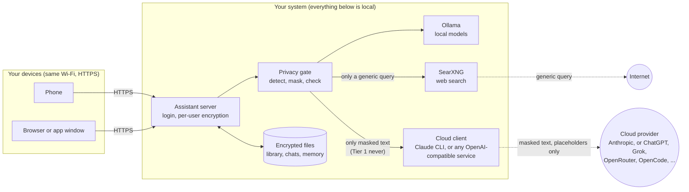
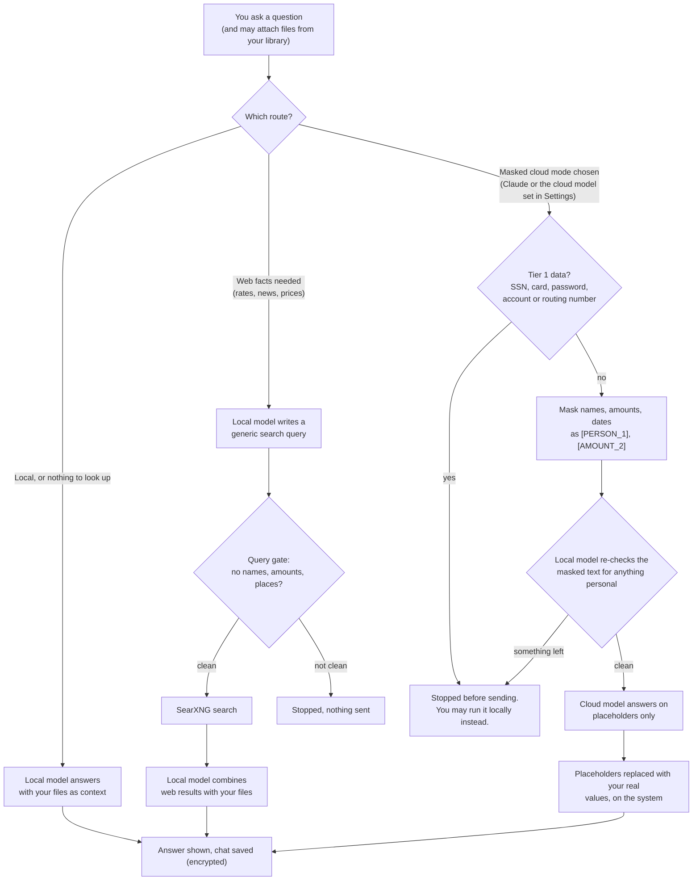
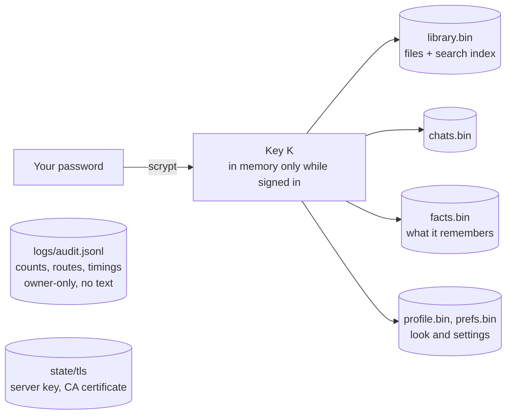
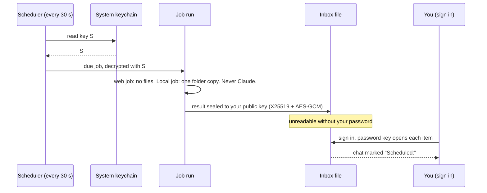
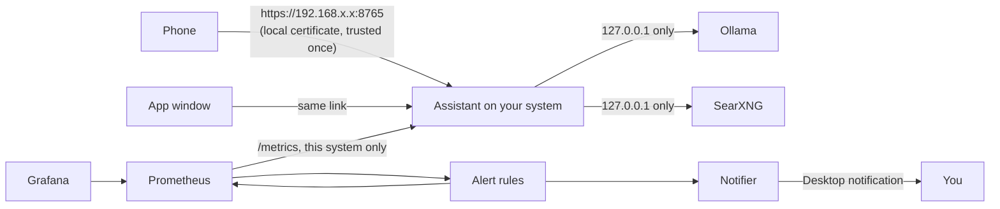
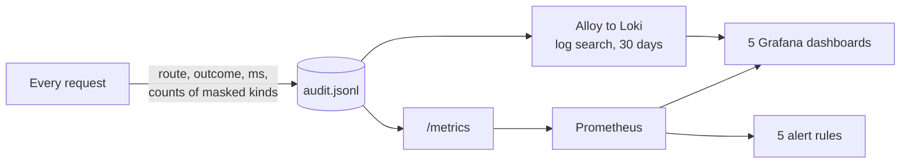

# How data flows

Pictures first, words after. The diagrams are Mermaid, so GitHub draws them; PNG copies are in `docs/diagrams/` for anywhere else. All names and numbers in the examples are fake.

## 1. The big picture

Everything private stays on the system that runs the assistant (a Mac, a Linux box or a Windows PC). Only three things ever leave it, and only in the form shown on the arrow.

- Solid arrows stay on this system or your own network. Dotted arrows leave it.
- The cloud step is one slot with two choices. Default: the Claude CLI you are signed in to. Alternative (Settings > Cloud model): any OpenAI-compatible service. Both get exactly the same masked text, and both go through the same single exit.
- The assistant process may only connect to this system itself. The one exit is `egress.py`, and a test fails if any other file opens a connection.

## 2. One question, step by step

- **Local** and **Local + web facts** answers are always written by the local model.
- The masked cloud route can use the Claude CLI or any OpenAI-compatible cloud model chosen in Settings (the second is **not tested with real providers yet**). Same masked text, same checks; only the destination changes.
- If the cloud model is unavailable, the fallback is the local model, never a retry with weaker masking.
- The "What happened" tracker in the app draws exactly these steps. Green steps stay on the system, orange steps leave it.

### The other outgoing calls, side by side

| Call | Where it goes | What it carries | Rules |
|---|---|---|---|
| Local model | Ollama on this system, or a private-network address you list in Settings (backups are tried in order) | Your question, files | Loopback or the listed private IPs only; unencrypted on the LAN |
| Library search | Ollama embeddings, same addresses | Text from your files | Same |
| Web search | SearXNG on this system, which asks the internet | One generic query | Query gate: no names, amounts, places; no proxies or redirects |
| Claude | Claude CLI (separate process) | Masked text | Tier 1 stop, masking, local re-check |
| Other cloud model | One https address you entered | Masked text | Same as Claude, plus: public addresses only, connection pinned to the vetted address, no redirects or proxies, key in the system keychain, host recorded in Activity, **not tested with real providers** |
| Monitoring | Prometheus on this system | Counts and timings | `/metrics` answers this system only |

Everything else is blocked by a guard that refuses any connection from the assistant process to an address that is not on this system.

## 3. What each party sees

| Party | Sees | Never sees |
|---|---|---|
| Local model (Ollama) | Your question, your files, web results | Nothing leaves this system through it |
| Web search (SearXNG) | A short generic query, such as "current 30-year mortgage rates" | Your name, amounts, files, the original question |
| Claude, or the cloud model you chose | Masked text with placeholders (the provider also sees that it came from you, through its own account and key) | Real values, Tier 1 data (never sent at all) |
| Other accounts on the system | Nothing | Your library, chats, memory (encrypted with your password) |
| Prometheus and Grafana | Counts, routes, timings | Any question or answer text |

## 4. What is stored, and how

- Files are AES-GCM encrypted per user. The key comes from the password and is never written to disk.
- There is no password recovery.
- A session ends after 8 hours idle, and the key leaves memory with it.

## 5. Scheduled jobs (optional, off by default)

Jobs run while you are signed out, so they cannot use your password key. A second key sits in the System keychain, and results are sealed so that only your password can open them.

- Jobs are skipped while you are asking something. A run that finds sensitive data fails and sends nothing.
- A forged or replayed result is marked "Unverified" or dropped.
- Honest limit: malware running as your user account could read the keychain key. Use disk encryption (for example FileVault) and a strong login password. Details: `docs/SCHEDULED-JOBS-DESIGN.md`.

## 6. Network and certificates

- `install.py --tls` makes a private certificate authority, signs one server certificate and throws the signing key away. Trust `state/tls/ca.crt` on each device once.
- Plain HTTP is not served in that mode, and the session cookie is marked Secure.
- Away from home, use Tailscale. Never forward a port on the router.
- Grafana (3000), Prometheus (9090) and node_exporter (9100) listen on this system only.

## 7. Monitoring, no text

Only counts, route names and timings reach the log. A test confirms that no question or answer text appears in `/metrics`.

## Where to read more

- `docs/THREAT-MODEL.md`: threats T1–T17 and the control for each.
- `docs/SCHEDULED-JOBS-DESIGN.md`: the scheduled-jobs key design.
- `PII-STANDARD.md`: the four data tiers.
- `FAQ.md`: limits and how-tos.
