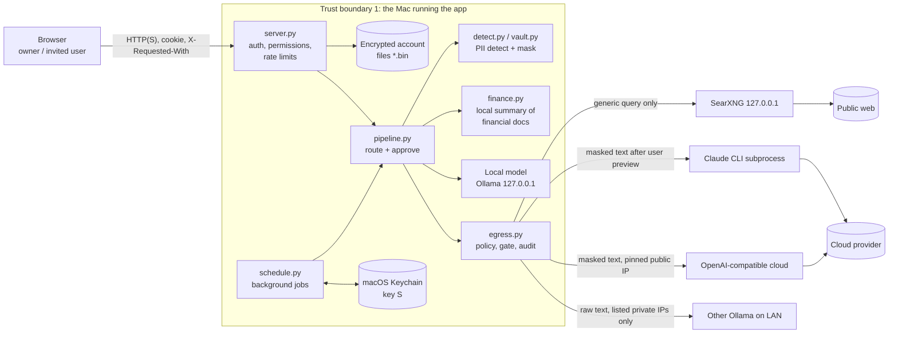

# Threat model (reviewer's view)

Assessment date: 2026-11-01. Baseline assessed commit (before any fixes; later state is in SECURITY_ASSESSMENT.md section 0 and the tracker): `40638c6`. Prepared by the project's AI coding assistant from the code and from `docs/THREAT-MODEL.md`, `docs/SECURITY.md`, `PII-STANDARD.md`. It is a self-assessment, not an independent audit. Where the project's own threat model and the code disagree, the code (as read or executed) wins and the difference is recorded in [FINDINGS.md](FINDINGS.md) (PH-017).

## 1. System in one paragraph

A Python web application (`ThreadingHTTPServer`, [`server.py`](https://github.com/hgharsha/privacy-hybrid/blob/main/src/privhybrid/server.py)) that lets a household or small group ask questions about their own documents. Everything is answered by a local model (Ollama or an OpenAI-compatible local server) unless the user chooses a web route (generic query through a local SearXNG) or a cloud route (Claude CLI or a configured OpenAI-compatible service) that receives only masked text after the user previews it. Per-account data is encrypted at rest with a key derived from the account password.

## 2. Assets

| Asset | Where it lives | Sensitivity |
|---|---|---|
| Uploaded documents and extracted text | `library.bin`, encrypted per account | High (financial, legal, identity) |
| Chats, remembered facts | `chats.bin`, `facts.bin` | High |
| Account password and derived file key | key only in process memory while signed in | Critical |
| Privacy policy (Extreme privacy, review-before-send) | `prefs.bin`, encrypted | High (integrity matters most) |
| Placeholder map (value ⇄ `[PERSON_1]`) | `Vault`, memory only, never pickled | High |
| Scheduler key S | macOS Keychain | High |
| Cloud API key (optional) | macOS Keychain or environment | High |
| TLS server key | `state/tls/server.key`, mode 0600 | Medium |
| Audit log | `logs/audit.jsonl`, counts and routes only | Low to Medium |
| Admin role, permissions, limits | `access.json`, `admin` | High (integrity) |

## 3. Actors

| Actor | Capability assumed |
|---|---|
| Owner / administrator | Controls the Mac, installs, sets Settings and permissions. Trusted. |
| Invited user | Has an account with limited permissions; browser access to the server. Not trusted with other users' data or with unrestricted cloud use. |
| Network-adjacent attacker | On the same LAN when the server is bound to a LAN address; can send arbitrary HTTP, sniff plain HTTP. |
| Malicious web page in the owner's browser | Can make cross-origin requests from the owner's browser (CSRF, DNS rebinding). |
| Local process as the same OS user | Can read the owner's files and the Keychain item the app created. **Out of scope** (as in the project's model): it can do everything the app can. |
| Cloud provider / third-party model host | Sees whatever is sent; has its own retention. |
| Supply-chain attacker | Compromises a dependency, model file or CI action. |
| Someone with a copy of the disk or a backup | Offline attack on encrypted files. |
| Content in documents / web results | Untrusted text that may carry prompt injection. |

## 4. Architecture and trust boundaries

Boundaries that matter:
1. **Browser ⇄ server** (LAN or loopback): authentication, CSRF, Host/Origin checks, TLS optional.
2. **Server ⇄ disk**: per-account AES-GCM, key from password; OS file permissions.
3. **Server ⇄ outside the machine**: the single exit `egress.send` / `egress.search`; in-process connection guard; optional OS firewall.
4. **Server ⇄ Claude CLI**: separate process, text on stdin, tools disabled.
5. **Scheduler ⇄ password key**: scheduler never holds the password key, only key S from the Keychain.
6. **Administrator ⇄ other users**: permission records, per-account encryption.

## 5. Data classification as implemented

| Tier | Examples (per `pii_policy.json`) | Behaviour |
|---|---|---|
| 1 | SSN, card, bank account, IBAN, government ID, medical diagnosis, credentials | Never sent. The request is stopped (`NeedsApproval`); no placeholder exists |
| 2 | Names, e-mail, phone, address, date of birth, employer | Replaced by placeholders; restored locally on the reply |
| 3 | Amounts, merchants, transactions, dates in ledgers | Placeholders; financial *documents* are replaced by a local summary |
| 4 | Lone place names | Not masked on their own; masked in combination (quasi-identifier rule) |
| Financial document | Recognised at intake from name, columns, wording, dated amounts | Cloud receives only a rounded aggregate summary, after user preview that cannot be turned off |

## 6. Outbound control chain for a cloud send

1. Permission `cloud` and daily quota for the account (`server.py:958-965`).
2. Extreme privacy re-read from disk (`policy.extreme`) at request start and again in `egress.send` immediately before transmission.
3. Tier 1 scan of the question and of every document; financial documents replaced by summaries (`pipeline.py`).
4. Masking with placeholders; re-detection of the masked text (`egress._recheck_masked`); known-values scan with normalisation (`Vault.leaks`).
5. Local second-pass model, fail-closed on any error or malformed reply (`local.second_pass`).
6. Size cap 60 KiB (`egress.MAX_PROMPT_BYTES`).
7. Preview of the exact outgoing text; no answer or a timeout means no (`server.py:988-1003`); mandatory for financial material.
8. Transmission: Claude CLI with no tools and an allow-listed environment, or an HTTPS service whose name must resolve to public addresses and the connection is pinned to the vetted address (`egress._cloud_access`).
9. Audit row with counts, route, host, timings, no text.

The assessment verified steps 1 to 4, 6 and 7 through the test suite and code reading, and step 5 only as far as a stub (see [TEST_EVIDENCE.md](TEST_EVIDENCE.md) section 5). It could not verify what the real Claude CLI transmits beyond stdin (PH-020).

## 7. Threats, controls, evidence and residual risk

Evidence key: **T** = covered by a passing automated test I ran; **R** = code read; **X** = executed probe by me; **U** = not verified.

| # | Threat | Control in code | Evidence | Residual / finding |
|---|---|---|---|---|
| A1 | Brute-force or credential stuffing on login | scrypt N=2^15; same-cost path for unknown e-mails; 5 failures per minute per address and per address+account | R, T | Account-wide throttle missing, modest KDF cost: PH-010, PH-011 |
| A2 | CSRF / cross-site writes | `X-Requested-With: privhybrid` plus Origin check on POST; `SameSite=Strict`; CSP `default-src 'self'` | R, T | Low |
| A3 | DNS rebinding | Host header must match known host:port on GET and POST | R, T | Low |
| A4 | XSS | No `innerHTML`/`eval`/`document.write` in `static/app.js` (search only); CSP forbids inline script | R (search) | `app.js` not read line by line |
| A5 | Session theft on the LAN | HttpOnly, SameSite=Strict, Secure only with TLS; 8 h idle expiry; sessions dropped on disable/password change | R, T | Plain HTTP allowed: PH-005 |
| A6 | First-visitor takeover | optional `PRIVHYBRID_SETUP_TOKEN` | R, T (token path) | No default token: PH-004 |
| A7 | One user reads or spends another's resources | Per-account key; session bound to account; permissions and limits re-read on each request | T (`test_multiuser.py`, `test_admin_locks.py`) | Admin can change settings but not read data; PH-013 (succession), PH-018 |
| A8 | Cross-process or cross-thread corruption | `flock` file locks with timeout; version-checked writes; fixed lock order; password change under locks with rollback | T, R | Rollback by stale file: PH-006 |
| B1 | PII reaches the cloud because the detector misses it | Layered regex, checksums, NER, user dictionary, local second pass, preview | T, X | PH-001, PH-002, PH-003; second-pass model quality U |
| B2 | Financial rows reach the cloud | Intake classification, local summary, always previewed, no approval path for scheduled jobs | T | Heuristic classification, "unparseable stays local" |
| B3 | Cloud send after Extreme privacy is on | Policy read from disk before each send; unknown means on | T | PH-006 (stale file), PH-007 (scheduler) |
| B4 | Prompt injection via web results or files | Results fenced and labelled untrusted; no tools for the local model; cloud CLI has tools disabled | R | No red-team corpus run; U |
| B5 | Data sent to an unintended host | Cloud URL validated; public-address pinning; redirects refused; LAN Ollama only literal private IPs and ports ≥ 1024 | T, R | PH-016 (in-process guard) |
| B6 | Data in logs | Audit log: counts and route; error text generic; canary tests | T | PH-019 |
| B7 | Claude CLI sends more than the preview | `--tools ""`, empty cwd, env allow-list | R | PH-020 (U) |
| C1 | Disk or backup copy | AES-GCM per file with filename as associated data; scrypt | R, X | PH-011; no rollback detection PH-006; plaintext cache PH-012 |
| C2 | Keychain secret misuse | Item per account; timeouts; failures skip the run | R | Same-user malware out of scope; ACL behaviour U |
| C3 | Replay or forged scheduler results | Sealed to user public key, MAC under key S, replay counter | T | Unverified items still displayed with a note |
| D1 | Slow clients, large uploads, archive bombs | Socket timeout, 64 connections, 8 MiB body, bounded pool, capped unzip, entity-free XML, page and size limits | T | PH-009 |
| D2 | Malicious file | Text-only extraction, no macros or external links, metadata not read, filename scanned | T, R | pypdf and spaCy are parser surface: PH-014 |
| E1 | Supply chain | Dependabot, `pip-audit`, CodeQL, gitleaks in CI | CI success U (logs not read) | PH-014, PH-015 |
| E2 | Root-run helper tampered | Fixed script path, validated user name; owner, mode and symlink check of the script and all parents immediately before the privileged run (local change, not yet merged; PH-008 still Open) | R | PH-008 |
| E3 | Privacy bug masked by test configuration | Security tests run with production defaults | T | Other 306 tests do not |

## 8. Assumptions the model depends on

- The Mac, its OS account and its disk encryption (FileVault) are not hostile.
- The owner, or whoever sets `PRIVHYBRID_BIND`, understands that a LAN bind is for trusted networks.
- Local models are run by software the owner trusts.
- Passwords are chosen with care; there is no recovery.

## 9. Out of scope (consistent with the project)

Same-user malware; physical access to an unlocked Mac; compromise of the cloud provider; nation-state adversaries; internet exposure of the port (explicitly "never").

## 10. Gaps in this threat model

- No formal data-flow review of `scripts/mac_shell.swift` or of the app wrapper installer.
- No analysis of the embedded speech model download (`scripts/fetch_voice_model.py` downloads from HuggingFace without a checksum, owner-run).
- Time-based and resource-exhaustion attacks were not measured.
